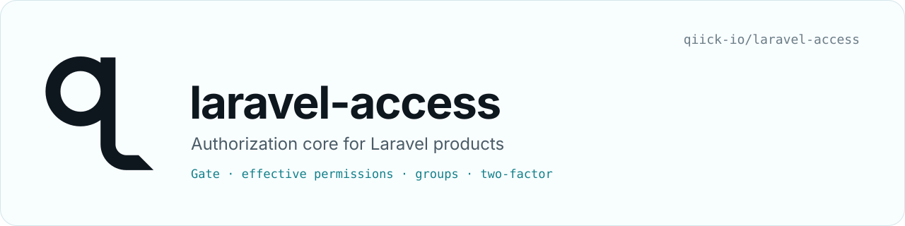

<p align="center">
  <picture>
    <source media="(prefers-color-scheme: dark)" srcset=".github/assets/header-dark.svg">
    <source media="(prefers-color-scheme: light)" srcset=".github/assets/header-light.svg">
    
  </picture>
</p>

# qiick/laravel-access

> **In development. Not released and not on Packagist yet: do not depend on it.**

Shared authorization core for qiick Laravel products: one `Gate::before`, the
effective-permission resolver (direct ∪ group roles, soft-deleted groups
excluded), a typed actor context so API actors never get the super-admin pass,
enforced 2FA middleware, the `EnsureUserHasPermission` route middleware and the
`AuthorizesWithPermission` FormRequest trait.

Part of the qiick fleet. Binding design:
`projects/qiick/packages/laravel-access-design.md` in the knowledge base
(overlays: `decisions/2026-11-22-laravel-access-package.md`,
`decisions/2026-11-22-mcp-oauth-and-access-design-answers.md`,
`decisions/2026-11-20-core-hardening.md`).

## Status

Pre-`0.1.0`. Public APIs may change in any 0.x release; see [UPGRADING.md](./UPGRADING.md).
Do not require this package from production apps until a tagged release lands on
Packagist (Packagist publish only after Luca’s go).

## Requirements

- PHP `^8.3`
- Illuminate auth / contracts / database / http / support `^12.0 \|\| ^13.0`
  (never `laravel/framework`)
- `spatie/laravel-permission` `^8.0`

## Install (when published)

```bash
composer require qiick/laravel-access
php artisan vendor:publish --tag=access-config
```

Products must bind `RoleCatalog`, `TwoFactorPolicy`, `TwoFactorResponder` and
`AuthorizationResponder`, set `permission.register_permission_check_method` to
`false`, and call `AccessContext::enter()` after verifying a credential. See
[docs/adoption.md](./docs/adoption.md) and
[docs/reference-contracts.md](./docs/reference-contracts.md).

## Threat model (short)

| Threat | Mitigation |
| --- | --- |
| Super-admin elevation through a key, grant or public door | `Gate::before` step 2 abstains for API actors; Spatie's permission callback off; AC2 |
| Future model-less check on an API path | Step 2 unconditional; `permission:` middleware and trait give API actors only scopes ∩ the owner's assigned permissions, never super-admin, and deny them when no `ApiActorScopeCheck` is bound; Policies use the resolver, never `$actor->can(<permission>)`; AC2, AC8, AC9 |
| Forged actor kind | Context bound only after verification; resolver never reads request input; either-signal rule; AC4 |
| Job escaping the key's limits | `CarriesActorContext` job middleware; AC5 |
| Stale permissions after demotion | `fresh` use-time checks, event and lifecycle clears, scoped resolver; AC6, AC11 |
| Soft-deleted group still grants | SQL `whereNull(deleted_at)`; C7 |
| Organisation bleed | Team id in the cache key; `switchTo()` clears; C29 |
| Super-admin overriding a Policy | Step 3 abstains when a Policy exists; AC3 |
| 2FA skipped | API actors exempt but get no Gate pass; exempt list minimal; AC10 |
| Missing binding failing open | Boot check; AC12 |
| Domain logic leaking into the package | Arch test against `App\`; no domain hook |
| A deleted user keeping a principal, or erasure leaving a principal behind | `principals.user_id` is `ON DELETE RESTRICT`; `eraseUser()` erases, unlinks and deletes the user in one transaction; `UserDeletionGuard` refuses every other delete of a user with principals |
| A principal owned across organisations, or a deactivated owner still counting | Owners must be active and in the same organisation; `isActive()` walks the owner chain uncached, with a fixed depth and cycle detection; deactivation cascades in one transaction and `PrincipalDeactivated` fires after commit |
| Two instance principals of one type, or an organisation-less member | Unique index and CHECK (triggers on SQLite) from the migration; race-safe `instance()`; P1–P3 |
| Principals config drifting from the schema | `Testing\AssertsPrincipalsSchema` proves the refusals on the product's migrated database; P9 |
| Supply chain | Pinned Actions, `composer audit`, no lockfile, alerts-only Dependabot |

## Development

```bash
composer update
composer test      # Pest
composer lint      # Pint
composer analyse   # PHPStan level max
```

Mutation targets (design §11) run per class at MSI ≥ 95 via
`scripts/mutate-per-class.sh` in CI. Real-HTTP middleware tests use `php -S`
(no shell wrapper; torn down in `tearDown`).

## License

MIT. See [LICENSE](./LICENSE).
